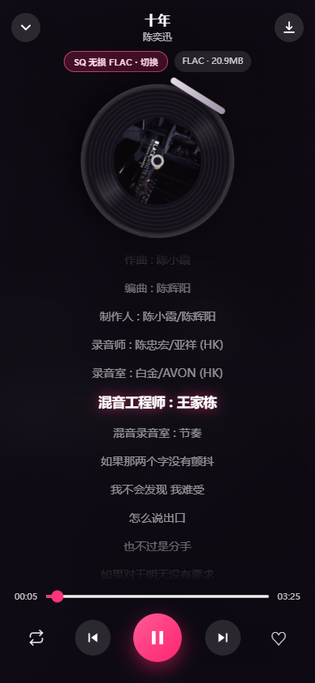
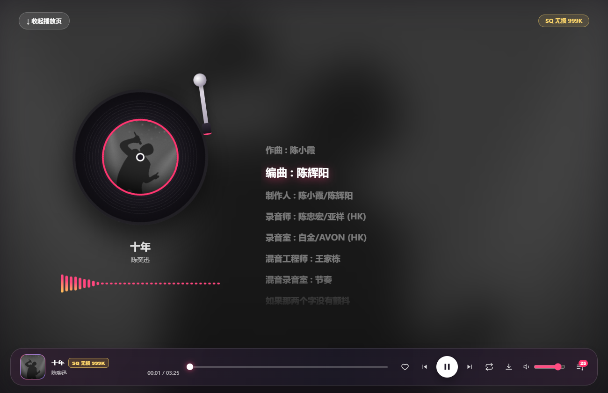

# 无损音乐播放器 (Lossless Music Player)

一款开箱即用、免登录的全平台 **Windows + macOS + Android + iOS** 无损音乐播放器，支持 **SQ 无损 FLAC** 在线畅听、同步滚动歌词与一键无损下载。

## 界面预览

### 手机端（Android / iOS）

<table>
  <tr>
    <td align="center">
      
       <b>首页 · 潮流黑胶拼贴 & 快捷入口</b>
    </td>
    <td align="center">
      
       <b>沉浸播放 · SQ 无损 FLAC & 同步滚动歌词</b>
    </td>
  </tr>
</table>

### 电脑端（Windows / macOS）

<table>
  <tr>
    <td align="center">
      
       <b>桌面首页 · 精选歌单 & 实时搜歌</b>
    </td>
    <td align="center">
      
       <b>沉浸播放 · 仿真黑胶唱臂 & 实时频谱</b>
    </td>
  </tr>
</table>

## 核心特性

- **四端全覆盖**：
  - **Windows 版**：Electron 便携单文件 `.exe`，双击即用，支持在线无损 + 本地离线扫描播放。
  - **macOS 版**：Electron `.dmg`（Apple Silicon `arm64` + Intel `x64` 双架构），开箱即用。
  - **Android 版**：原生 WebView + 内置 `127.0.0.1` 无损代理 + 息屏前台保活 + 系统下载直存 `Music/无损音乐/`。
  - **iOS 版**：纯 Swift 原生壳 + `Network.framework` 本地无损流代理 + `AVAudioSession` 后台息屏播放 + 系统分享存至“文件”App（未签名 `.ipa`，支持巨魔 TrollStore / 爱思助手 / Sideloadly / AltStore 自签安装）。
- **免登录即开即用**：热门精选歌单、7 大官方排行榜（新歌 / 热歌 / 飙升 / 原创 / 抖音 / 欧美 / 日语）与全网搜歌。
- **真无损 FLAC 播放与音质切换**：优先解析 `SQ 无损 FLAC` 音频流，支持 `SQ 无损 / 320K HQ / 192K / 128K` 实时切换。
- **沉浸黑胶滚动歌词**：仿真旋转黑胶唱片与唱臂、自动同步滚动歌词（点击歌词跳转进度）。

## 下载使用

前往本仓库右侧 **[Releases](https://github.com/hxhptt-dotcom/lossless-music-player/releases)** 下载对应安装包：

- **Windows 电脑**：`LosslessMusicPlayer-v1.0.0-win-x64.exe`
- **Mac 电脑（M 芯片 / Intel）**：`LosslessMusicPlayer-v1.0.0-mac-arm64.dmg` / `LosslessMusicPlayer-v1.0.0-mac-x64.dmg`（未公证，首次打开请右键点击“打开”）
- **Android 手机**：`LosslessMusicPlayer-v1.0.0-android.apk`（已签名，直接安装）
- **iPhone / iPad**：`LosslessMusicPlayer-v1.0.0-ios-unsigned.ipa`（未签名，使用巨魔 / 爱思助手 / Sideloadly / AltStore 自签安装）

## 本地开发与云端构建

- **Windows / macOS**：`npm install` 后执行 `npm start`（开发）、`npm run build`（Win EXE）或 `npm run build:mac`（Mac DMG）。
- **Android / iOS**：已配置 GitHub Actions（`.github/workflows/build-android.yml` 与 `.github/workflows/build-apple.yml`），推送至 `main` 自动编译并同步发布到 Releases。

## 致谢与声明

- **特别致谢**：本项目的创意、界面风格灵感及最初思路均源自 **LINUX DO（L 站）** 社区大佬的分享，向原作者表示诚挚感谢！
  - 原贴地址：[https://linux.do/t/topic/3218803](https://linux.do/t/topic/3218803)
- **开源与免责声明**：本项目仅用于个人技术学习、跨平台客户端封装与交流分享，不存储任何音频文件，亦不用于任何商业用途；如有侵权或原作者有下架/署名修改要求，请随时联系处理。
